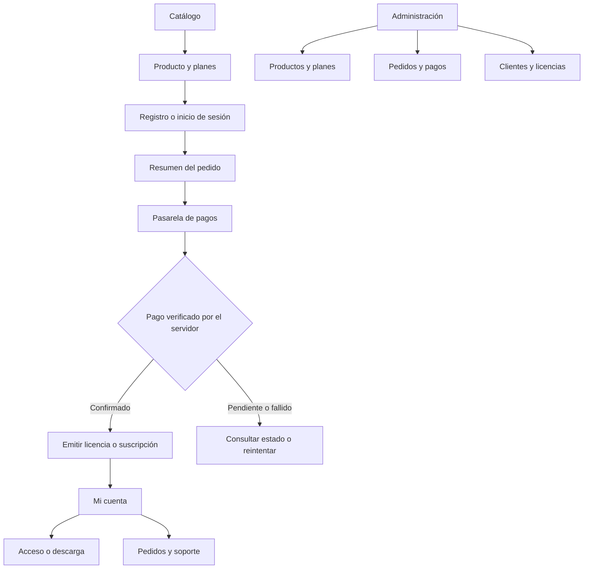
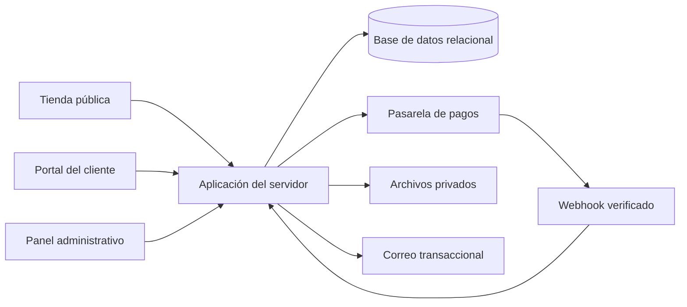
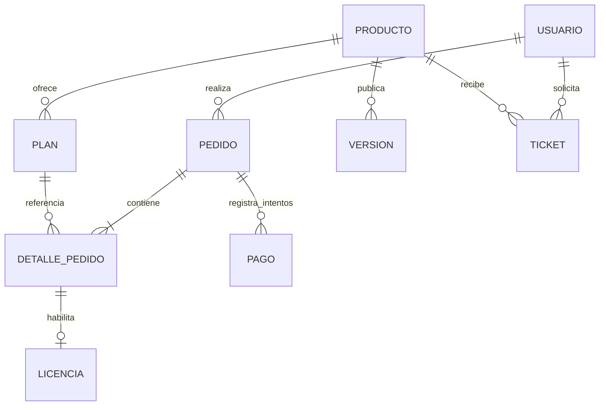

# Karpanda — venta de software

Propuesta conceptual inicial. El proyecto contiene dos imágenes de marca y aún no tiene implementación. El objetivo confirmado es vender software. Los productos, precios, planes y reglas siguientes son ilustrativos y requieren validación.

## Alcance propuesto

- Tienda: catálogo, ficha de producto, funciones, requisitos, planes y condiciones.
- Compra: cuenta del cliente, resumen del pedido y pago mediante pasarela.
- Cliente: pedidos, licencias o suscripciones, acceso al software, descargas autorizadas y soporte.
- Administración: productos, planes, versiones, pedidos, pagos, clientes, licencias y tickets.

## Mapa de navegación

## Plano de arquitectura

La tecnología queda por definir. La carpeta se encuentra dentro de XAMPP, por lo que PHP con MySQL es una opción de implementación, no una decisión confirmada.

## Modelo de datos propuesto

Campos esenciales:

| Entidad | Campos |
|---|---|
| Usuario | id, nombre, email único, contraseña cifrada mediante hash, rol |
| Producto | id, nombre, slug, descripción, requisitos, modalidad, estado |
| Plan | id, producto_id, nombre, precio, moneda, periodicidad, límites |
| Pedido | id, usuario_id, estado, subtotal, impuestos, total, moneda |
| Detalle de pedido | id, pedido_id, plan_id, nombre y precio históricos |
| Pago | id, pedido_id, proveedor, referencia externa única, importe, estado |
| Licencia | id, detalle_id único, estado, inicio, vencimiento, límite de activaciones |
| Versión | id, producto_id, versión, ubicación privada, fecha |
| Ticket | id, usuario_id, producto_id, asunto, estado |

## Reglas de operación

1. El servidor calcula el importe usando el plan vigente y conserva una copia del precio en el pedido.
2. El retorno del navegador desde la pasarela no confirma el pago. Se verifica en el servidor mediante la integración seleccionada.
3. Los eventos de pago repetidos no duplican licencias. Se usan referencias externas únicas y emisión idempotente.
4. Solo el propietario puede ver su pedido, licencia, archivo o ticket; los administradores actúan según permisos.
5. Si el software es SaaS, se habilita acceso. Si es descargable, se entrega una versión mediante acceso temporal autorizado.
6. Los estados de pago, pedido y licencia se mantienen separados; cancelaciones, reembolsos y renovaciones requieren reglas comerciales por definir.

## Planos de pantalla

| Pantalla | Distribución y acción principal |
|---|---|
| Catálogo | Marca y navegación → propuesta de valor → tarjetas de software con precio → ver producto |
| Producto | Descripción, vista y funciones a la izquierda → plan, precio y compra a la derecha |
| Compra | Datos del comprador a la izquierda → resumen y confirmación a la derecha |
| Cliente | Software y estado de licencia → acceso o descargas → pedidos y soporte |
| Administración | Tabla de productos → módulos de pedidos, licencias, clientes y soporte |
| Móvil | Columnas apiladas; navegación flexible; acciones visibles y formularios de ancho completo |

## Decisiones pendientes

- Productos reales y público objetivo.
- Venta de licencias perpetuas, suscripciones SaaS, proyectos a medida o combinación.
- Moneda, impuestos, precios, países de venta y proveedor de pagos.
- Política de soporte, renovación, cancelación, reembolsos y activaciones.
- Uso definitivo de las imágenes de marca disponibles.

## Prototipo

`karpanda-prototipo.html` es una visualización interactiva para revisar en la conversación. Incluye catálogo, detalle de producto, compra simulada, área de cliente, administración y planos. No procesa pagos, crea cuentas, emite licencias ni descarga software real.
